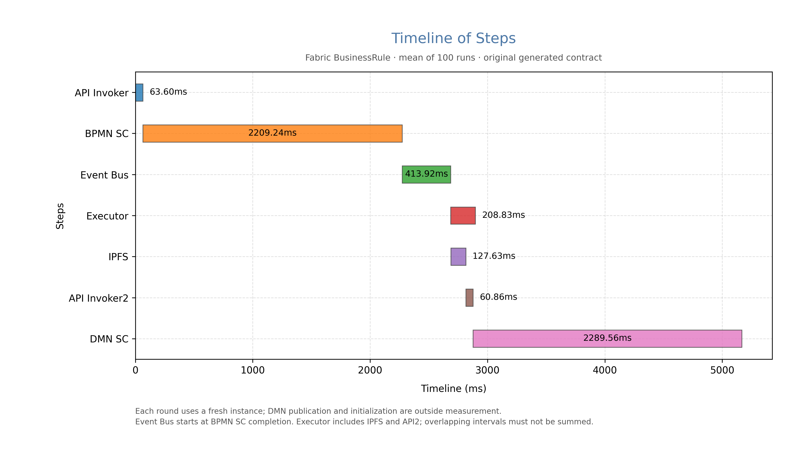

# Fabric BusinessRule 分阶段时延

状态：passed；有效样本：100；总尝试：100。

| 阶段 | 均值(ms) | 中位数(ms) | 最小(ms) | 最大(ms) |
|---|---:|---:|---:|---:|
| API Invoker | 63.60 | 54.25 | 44.25 | 225.65 |
| BPMN SC | 2209.24 | 2209.66 | 2169.96 | 2281.22 |
| Event Bus | 413.92 | 414.14 | 407.36 | 420.51 |
| Executor | 208.83 | 204.71 | 87.61 | 442.75 |
| IPFS | 127.63 | 130.02 | 21.87 | 331.81 |
| API Invoker2 | 60.86 | 51.95 | 44.18 | 217.58 |
| DMN SC | 2289.56 | 2267.66 | 2189.57 | 2618.93 |

| 轮次 | 实例 | API Invoker | BPMN SC | Event Bus | Executor | IPFS | API Invoker2 | DMN SC |
|---|---|---:|---:|---:|---:|---:|---:|---:|
| 1 | 4 | 59.41 | 2231.77 | 417.61 | 199.63 | 114.50 | 59.45 | 2533.66 |
| 2 | 5 | 51.19 | 2219.47 | 409.19 | 207.56 | 125.63 | 64.12 | 2433.70 |
| 3 | 6 | 48.26 | 2202.45 | 412.26 | 226.58 | 155.59 | 57.00 | 2262.71 |
| 4 | 7 | 62.22 | 2214.18 | 414.04 | 178.67 | 104.21 | 53.97 | 2308.86 |
| 5 | 8 | 55.26 | 2219.49 | 407.36 | 189.45 | 130.74 | 49.57 | 2276.33 |
| 6 | 9 | 66.91 | 2197.67 | 413.02 | 373.49 | 142.08 | 216.36 | 2327.17 |
| 7 | 10 | 58.22 | 2203.74 | 418.57 | 181.14 | 115.80 | 44.94 | 2268.65 |
| 8 | 11 | 47.79 | 2197.36 | 411.68 | 118.53 | 54.15 | 45.68 | 2268.66 |
| 9 | 12 | 46.36 | 2169.96 | 409.50 | 215.06 | 140.85 | 51.40 | 2353.37 |
| 10 | 13 | 53.27 | 2185.12 | 417.07 | 100.65 | 35.44 | 48.68 | 2246.21 |
| 11 | 14 | 58.57 | 2263.14 | 414.90 | 237.40 | 170.11 | 49.31 | 2306.11 |
| 12 | 15 | 49.42 | 2215.18 | 414.23 | 150.32 | 75.45 | 52.30 | 2375.05 |
| 13 | 16 | 54.31 | 2218.54 | 412.04 | 194.52 | 110.37 | 57.66 | 2375.06 |
| 14 | 17 | 45.32 | 2207.87 | 411.62 | 401.38 | 164.91 | 211.91 | 2282.80 |
| 15 | 18 | 53.90 | 2216.47 | 415.79 | 200.92 | 127.45 | 57.55 | 2342.61 |
| 16 | 19 | 54.52 | 2206.31 | 408.13 | 181.93 | 113.80 | 53.63 | 2390.83 |
| 17 | 20 | 44.46 | 2219.72 | 415.59 | 240.05 | 171.62 | 50.55 | 2267.37 |
| 18 | 21 | 55.88 | 2225.75 | 408.09 | 87.61 | 24.76 | 47.16 | 2249.33 |
| 19 | 22 | 56.75 | 2240.36 | 415.76 | 287.95 | 211.91 | 52.01 | 2294.75 |
| 20 | 23 | 49.77 | 2219.88 | 415.04 | 236.45 | 163.03 | 49.83 | 2303.03 |
| 21 | 24 | 64.09 | 2216.69 | 418.46 | 208.51 | 135.14 | 56.83 | 2359.09 |
| 22 | 25 | 47.44 | 2205.63 | 411.66 | 110.13 | 31.09 | 60.57 | 2304.10 |
| 23 | 26 | 58.22 | 2222.95 | 418.48 | 233.83 | 170.67 | 45.44 | 2276.34 |
| 24 | 27 | 58.47 | 2231.15 | 412.18 | 125.20 | 47.65 | 45.77 | 2315.45 |
| 25 | 28 | 53.08 | 2213.03 | 417.67 | 212.86 | 143.25 | 51.90 | 2240.87 |
| 26 | 29 | 215.43 | 2203.79 | 412.47 | 145.00 | 75.85 | 49.82 | 2378.97 |
| 27 | 30 | 44.59 | 2196.01 | 416.98 | 283.45 | 209.99 | 50.36 | 2618.93 |
| 28 | 31 | 206.50 | 2224.31 | 418.37 | 222.82 | 139.21 | 56.33 | 2350.56 |
| 29 | 32 | 54.82 | 2220.23 | 415.75 | 182.00 | 113.99 | 53.64 | 2240.52 |
| 30 | 33 | 52.87 | 2215.55 | 410.32 | 229.67 | 129.08 | 60.43 | 2262.68 |
| 31 | 34 | 56.64 | 2196.35 | 411.65 | 402.42 | 331.81 | 51.28 | 2432.82 |
| 32 | 35 | 62.49 | 2203.77 | 414.97 | 193.60 | 117.54 | 59.69 | 2321.10 |
| 33 | 36 | 49.47 | 2186.61 | 414.93 | 239.22 | 163.01 | 54.67 | 2378.13 |
| 34 | 37 | 58.90 | 2193.00 | 413.48 | 225.70 | 164.89 | 47.45 | 2280.67 |
| 35 | 38 | 223.56 | 2187.83 | 414.07 | 202.51 | 129.31 | 49.02 | 2392.06 |
| 36 | 39 | 59.20 | 2192.23 | 416.29 | 312.87 | 224.61 | 66.68 | 2344.87 |
| 37 | 40 | 223.15 | 2199.27 | 411.57 | 136.65 | 61.12 | 49.74 | 2426.53 |
| 38 | 41 | 49.64 | 2217.79 | 411.56 | 248.06 | 169.05 | 49.86 | 2324.79 |
| 39 | 42 | 45.00 | 2214.40 | 415.73 | 208.67 | 140.06 | 48.62 | 2317.45 |
| 40 | 43 | 47.86 | 2189.30 | 417.99 | 268.81 | 178.51 | 65.07 | 2331.90 |
| 41 | 44 | 56.49 | 2189.37 | 412.96 | 400.24 | 145.09 | 214.39 | 2280.74 |
| 42 | 45 | 46.07 | 2208.98 | 408.81 | 431.41 | 192.03 | 211.03 | 2274.14 |
| 43 | 46 | 51.97 | 2281.22 | 411.92 | 216.40 | 135.01 | 52.42 | 2257.84 |
| 44 | 47 | 61.85 | 2230.04 | 416.31 | 103.05 | 29.44 | 54.93 | 2307.58 |
| 45 | 48 | 48.10 | 2210.34 | 413.75 | 203.88 | 136.52 | 48.33 | 2233.49 |
| 46 | 49 | 50.44 | 2207.45 | 412.16 | 107.13 | 38.96 | 56.34 | 2292.55 |
| 47 | 50 | 49.55 | 2179.11 | 408.04 | 243.22 | 178.62 | 50.97 | 2267.95 |
| 48 | 51 | 50.15 | 2206.96 | 410.41 | 180.58 | 110.21 | 55.15 | 2246.55 |
| 49 | 52 | 60.38 | 2202.36 | 416.44 | 205.53 | 135.43 | 51.69 | 2283.40 |
| 50 | 53 | 44.25 | 2189.57 | 416.09 | 315.12 | 243.57 | 57.20 | 2238.51 |
| 51 | 54 | 49.19 | 2209.51 | 419.82 | 172.82 | 91.97 | 54.39 | 2300.48 |
| 52 | 55 | 60.96 | 2211.62 | 412.67 | 237.09 | 161.37 | 61.02 | 2228.18 |
| 53 | 56 | 54.37 | 2204.27 | 414.22 | 203.63 | 142.79 | 48.15 | 2290.07 |
| 54 | 57 | 57.08 | 2187.03 | 414.37 | 186.57 | 125.49 | 50.06 | 2242.78 |
| 55 | 58 | 56.60 | 2191.77 | 410.38 | 251.26 | 177.12 | 46.66 | 2227.73 |
| 56 | 59 | 58.34 | 2197.83 | 407.57 | 107.65 | 35.41 | 51.82 | 2210.75 |
| 57 | 60 | 50.55 | 2202.55 | 414.77 | 266.58 | 187.17 | 61.32 | 2236.28 |
| 58 | 61 | 55.34 | 2223.25 | 416.75 | 230.32 | 158.38 | 57.11 | 2238.66 |
| 59 | 62 | 49.08 | 2214.05 | 416.47 | 179.93 | 106.59 | 48.00 | 2240.85 |
| 60 | 63 | 61.59 | 2237.26 | 416.23 | 260.65 | 187.96 | 53.72 | 2215.44 |
| 61 | 64 | 49.29 | 2212.46 | 420.51 | 114.44 | 42.37 | 51.51 | 2284.83 |
| 62 | 65 | 61.70 | 2194.78 | 419.87 | 219.03 | 143.52 | 58.66 | 2247.23 |
| 63 | 66 | 53.47 | 2211.53 | 414.65 | 189.14 | 110.72 | 56.06 | 2256.20 |
| 64 | 67 | 44.53 | 2221.47 | 414.04 | 90.72 | 21.87 | 44.18 | 2543.71 |
| 65 | 68 | 61.14 | 2216.19 | 420.43 | 249.68 | 175.72 | 53.57 | 2253.88 |
| 66 | 69 | 48.61 | 2188.75 | 412.74 | 442.75 | 209.04 | 217.58 | 2234.00 |
| 67 | 70 | 46.61 | 2219.16 | 409.51 | 219.01 | 127.30 | 59.39 | 2282.62 |
| 68 | 71 | 53.75 | 2220.45 | 416.37 | 234.96 | 151.95 | 59.08 | 2252.57 |
| 69 | 72 | 62.67 | 2213.43 | 413.90 | 198.61 | 111.08 | 56.63 | 2253.67 |
| 70 | 73 | 56.35 | 2253.03 | 417.95 | 145.50 | 78.92 | 45.06 | 2356.17 |
| 71 | 74 | 46.37 | 2187.60 | 413.52 | 162.05 | 100.71 | 49.77 | 2189.57 |
| 72 | 75 | 54.16 | 2209.81 | 409.41 | 224.83 | 161.42 | 48.58 | 2316.55 |
| 73 | 76 | 52.91 | 2196.55 | 413.22 | 244.45 | 178.05 | 50.31 | 2246.24 |
| 74 | 77 | 54.37 | 2179.21 | 410.91 | 205.70 | 135.11 | 53.02 | 2269.25 |
| 75 | 78 | 46.72 | 2221.24 | 415.40 | 178.51 | 108.18 | 51.49 | 2252.29 |
| 76 | 79 | 50.66 | 2193.98 | 414.49 | 97.20 | 25.53 | 48.52 | 2256.36 |
| 77 | 80 | 62.05 | 2231.78 | 417.99 | 260.17 | 189.66 | 50.85 | 2245.88 |
| 78 | 81 | 54.21 | 2223.07 | 415.80 | 249.60 | 170.34 | 58.94 | 2303.67 |
| 79 | 82 | 61.00 | 2217.52 | 414.42 | 289.74 | 212.47 | 54.13 | 2249.37 |
| 80 | 83 | 54.13 | 2176.16 | 412.85 | 182.12 | 109.71 | 48.15 | 2232.09 |
| 81 | 84 | 46.15 | 2189.27 | 412.65 | 184.86 | 115.98 | 46.06 | 2259.73 |
| 82 | 85 | 225.65 | 2202.52 | 409.95 | 101.09 | 30.82 | 49.00 | 2254.77 |
| 83 | 86 | 54.29 | 2219.37 | 410.21 | 184.63 | 121.80 | 48.80 | 2228.53 |
| 84 | 87 | 48.64 | 2208.72 | 414.82 | 206.85 | 134.74 | 51.84 | 2306.41 |
| 85 | 88 | 59.64 | 2188.85 | 417.81 | 98.70 | 28.74 | 49.84 | 2226.46 |
| 86 | 89 | 52.41 | 2194.58 | 415.56 | 198.18 | 115.96 | 55.66 | 2243.78 |
| 87 | 90 | 50.30 | 2216.81 | 414.28 | 94.24 | 26.94 | 50.23 | 2276.14 |
| 88 | 91 | 55.29 | 2201.06 | 414.60 | 138.74 | 75.04 | 44.30 | 2240.77 |
| 89 | 92 | 55.86 | 2212.61 | 414.50 | 214.66 | 148.08 | 47.78 | 2248.64 |
| 90 | 93 | 46.31 | 2208.71 | 414.95 | 180.37 | 104.75 | 55.21 | 2216.34 |
| 91 | 94 | 46.80 | 2206.04 | 411.01 | 227.22 | 162.48 | 46.99 | 2243.27 |
| 92 | 95 | 50.62 | 2219.71 | 413.27 | 185.39 | 111.74 | 54.55 | 2238.94 |
| 93 | 96 | 54.03 | 2224.75 | 413.13 | 187.64 | 121.20 | 52.98 | 2234.67 |
| 94 | 97 | 61.14 | 2212.34 | 413.09 | 195.16 | 127.44 | 50.67 | 2249.06 |
| 95 | 98 | 57.16 | 2206.87 | 413.33 | 112.30 | 25.53 | 61.76 | 2265.00 |
| 96 | 99 | 212.69 | 2219.23 | 413.78 | 235.77 | 152.59 | 58.18 | 2243.44 |
| 97 | 100 | 61.02 | 2220.09 | 411.58 | 244.96 | 168.39 | 59.04 | 2229.90 |
| 98 | 101 | 66.22 | 2212.51 | 415.18 | 194.33 | 119.67 | 57.46 | 2248.38 |
| 99 | 102 | 49.55 | 2181.54 | 415.22 | 189.45 | 121.95 | 48.59 | 2251.80 |
| 100 | 103 | 56.10 | 2200.86 | 408.69 | 205.54 | 138.51 | 50.84 | 2245.53 |

Executor覆盖IPFS下载和第二次API调用，阶段不可相加。Event Bus起点与BPMN SC终点共用同一业务成功事件时间，结束于执行器收到对应DMNContentRequired。包含成功通知之后的事件监听、接收记录及WebSocket分发等待；eventBusBreakdown保留两部分明细。
DMN SC覆盖BPMN Continue、DMNEngine链内调用、交易提交和成功事件处理，并非单独DMN引擎CPU耗时。
每轮使用生成器原始链码的新实例；初始化、DMN发布、Oracle CID绑定和Start调用均在计时外。未改动BusinessRule状态转换。
全部有效轮次原样保留，未按链上耗时筛除慢样本。DMN从同一IPFS网关按预先发布的CID下载，包含本地已存内容的读取条件，不代表冷缓存远端发现时延。

