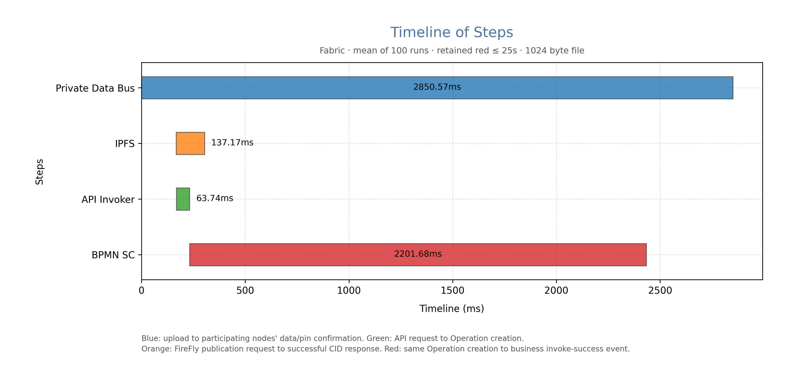

# Fabric 文件 Message 分阶段耗时

状态：passed；保留 100 轮。

同一已部署链码、同一实例、可重复文件 Message；红绿共用 Operation.created 边界。

筛选配置：{"maxRed_ms": 25000.0, "targetAcceptedCount": 100, "strategy": "batch_then_filter_then_refill", "acceptedCount": 100, "totalAttempts": 108, "excludedHighRedCount": 0, "excludedInvalidTimingCount": 8}

均值是按所设阈值筛选后的条件统计；目前仅保留有效100轮原始数据，失败与排除明细已按用户要求删除。

| 阶段 | 样本数 | 平均(ms) | 中位数(ms) | 最小(ms) | 最大(ms) |
|---|---:|---:|---:|---:|---:|
| Private Data Bus | 100 | 2850.57 | 2828.94 | 2788.70 | 3028.59 |
| IPFS | 100 | 137.17 | 126.39 | 100.54 | 290.98 |
| API Invoker | 100 | 63.74 | 56.97 | 45.34 | 227.08 |
| BPMN SC | 100 | 2201.68 | 2202.09 | 2160.83 | 2232.04 |

实际上传每轮内容不同的1KiB文件。文件字段orderDetails为必填file；requestId固定为1，用于避免生成器空StateMemory与当前Fabric合约框架的兼容问题。

链码由当前生成器生成，实验副本仅删除Message_1wswgqu_Send中将状态置为WAITINGFORCONFIRMATION的一行，其余代码与生成器输出一致；实际Fabric安装包内源码已逐字节核验。

蓝：上传请求开始至双方消息确认、batch pin成功和IPFS发布响应完成的最晚时间。黄：blob/publish完整成功响应返回CID的请求耗时。绿：业务请求开始至Operation.created。红：同一Operation.created至关联业务成功事件.created。红绿严格衔接。

共108次尝试，8次无效计时被单列排除；没有红色超过25秒的样本。有效100轮的逐轮核验、原始数据及校准证据均保留；失败与排除记录已按要求删除。
