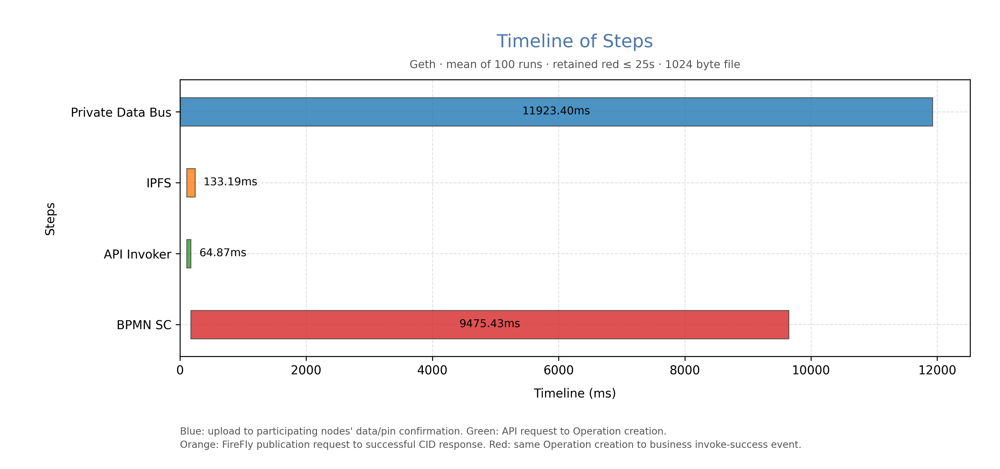

# 同一 Message 连续调用：分阶段耗时结果

共执行134次尝试，按预设红色阈值≤25秒保留100轮；排除红色超阈值21次、无效计时13次。下表是筛选后结果，不代表未经筛选的全体延迟。合约 `0x095a7a9b5a9b47ddaeac88f466d8d895b7a2eb72`，方法 `Message_1wswgqu_Send`，实例 `0`。

| 阶段 | 平均(ms) | 中位数(ms) | 最小(ms) | 最大(ms) |
|---|---:|---:|---:|---:|
| Private Data Bus | 11923.40 | 10317.94 | 3422.59 | 30183.94 |
| IPFS | 133.19 | 124.33 | 95.10 | 514.30 |
| API Invoker | 64.87 | 57.90 | 46.41 | 230.01 |
| BPMN SC | 9475.43 | 7939.13 | 737.03 | 24857.36 |

| 轮次 | 实例 | 蓝(ms) | 黄(ms) | 绿(ms) | 红(ms) |
|---|---:|---:|---:|---:|---:|
| 1 | 0 | 12804.05 | 139.23 | 52.84 | 12122.47 |
| 2 | 0 | 18678.24 | 124.90 | 55.52 | 17959.40 |
| 3 | 0 | 22332.63 | 120.89 | 63.39 | 3538.50 |
| 4 | 0 | 11401.65 | 127.28 | 53.59 | 10733.80 |
| 5 | 0 | 5468.86 | 134.78 | 69.77 | 4779.52 |
| 6 | 0 | 5611.08 | 119.39 | 53.07 | 4915.68 |
| 7 | 0 | 20651.40 | 141.49 | 51.74 | 19981.06 |
| 8 | 0 | 20239.18 | 132.32 | 59.36 | 19446.57 |
| 9 | 0 | 6903.44 | 141.55 | 51.82 | 6203.24 |
| 10 | 0 | 16332.92 | 124.46 | 46.98 | 15667.42 |
| 11 | 0 | 5994.76 | 131.39 | 63.32 | 5309.67 |
| 12 | 0 | 7136.00 | 152.31 | 56.32 | 6455.98 |
| 13 | 0 | 12980.82 | 132.43 | 52.80 | 12263.78 |
| 14 | 0 | 9894.00 | 137.89 | 57.08 | 8617.28 |
| 15 | 0 | 10116.09 | 133.83 | 72.78 | 9446.19 |
| 16 | 0 | 14162.83 | 144.53 | 59.61 | 13502.55 |
| 17 | 0 | 18096.12 | 124.54 | 62.99 | 17419.02 |
| 18 | 0 | 20089.72 | 111.86 | 58.09 | 2343.61 |
| 19 | 0 | 7114.10 | 130.14 | 67.63 | 6422.19 |
| 20 | 0 | 13852.63 | 111.03 | 212.99 | 9006.21 |
| 21 | 0 | 12888.00 | 123.82 | 215.29 | 3023.19 |
| 22 | 0 | 10774.97 | 128.79 | 66.31 | 10075.13 |
| 23 | 0 | 15834.45 | 128.91 | 53.96 | 15124.97 |
| 24 | 0 | 6828.24 | 113.24 | 52.75 | 6139.90 |
| 25 | 0 | 6368.11 | 124.35 | 63.68 | 5681.64 |
| 26 | 0 | 29836.54 | 115.48 | 52.17 | 3012.18 |
| 27 | 0 | 7419.13 | 114.88 | 62.78 | 6726.29 |
| 28 | 0 | 22485.92 | 124.85 | 65.03 | 21806.15 |
| 29 | 0 | 13303.89 | 124.18 | 59.29 | 12615.71 |
| 30 | 0 | 12647.58 | 136.42 | 62.15 | 11966.70 |
| 31 | 0 | 22553.83 | 103.99 | 50.73 | 21900.95 |
| 32 | 0 | 12622.26 | 108.07 | 51.20 | 11984.82 |
| 33 | 0 | 26514.06 | 110.05 | 63.50 | 737.03 |
| 34 | 0 | 11661.22 | 124.30 | 54.17 | 3948.32 |
| 35 | 0 | 7208.82 | 119.19 | 46.67 | 6516.38 |
| 36 | 0 | 14603.82 | 118.96 | 62.30 | 13933.31 |
| 37 | 0 | 12496.92 | 273.94 | 76.55 | 11785.28 |
| 38 | 0 | 21366.71 | 111.95 | 50.27 | 20706.43 |
| 39 | 0 | 8166.32 | 134.05 | 61.51 | 7476.07 |
| 40 | 0 | 3911.03 | 106.66 | 49.21 | 3263.49 |
| 41 | 0 | 9752.13 | 138.39 | 54.54 | 9081.58 |
| 42 | 0 | 8483.91 | 132.91 | 52.67 | 7825.41 |
| 43 | 0 | 5207.11 | 121.72 | 56.92 | 4549.74 |
| 44 | 0 | 10223.31 | 152.22 | 67.08 | 9458.99 |
| 45 | 0 | 15244.45 | 127.31 | 58.48 | 14585.95 |
| 46 | 0 | 4050.66 | 107.81 | 230.01 | 3209.25 |
| 47 | 0 | 30183.94 | 131.53 | 66.23 | 3393.37 |
| 48 | 0 | 15082.57 | 126.12 | 53.08 | 14416.62 |
| 49 | 0 | 7455.54 | 207.66 | 83.33 | 6747.75 |
| 50 | 0 | 22142.04 | 103.16 | 61.92 | 3402.98 |
| 51 | 0 | 8891.84 | 123.79 | 54.23 | 8215.66 |
| 52 | 0 | 4002.15 | 108.64 | 51.74 | 3313.99 |
| 53 | 0 | 6969.60 | 118.69 | 67.05 | 6264.92 |
| 54 | 0 | 6018.06 | 114.54 | 63.35 | 5352.21 |
| 55 | 0 | 17117.25 | 134.27 | 67.13 | 16429.25 |
| 56 | 0 | 8284.95 | 110.25 | 65.90 | 7618.48 |
| 57 | 0 | 16221.32 | 112.76 | 49.85 | 15538.60 |
| 58 | 0 | 6620.49 | 125.73 | 61.50 | 5947.68 |
| 59 | 0 | 5756.44 | 122.34 | 62.25 | 5068.70 |
| 60 | 0 | 6709.34 | 117.64 | 57.73 | 6043.93 |
| 61 | 0 | 12449.38 | 129.51 | 67.80 | 11765.99 |
| 62 | 0 | 7040.26 | 514.30 | 80.05 | 6250.32 |
| 63 | 0 | 5870.86 | 107.11 | 46.41 | 5203.88 |
| 64 | 0 | 8780.00 | 107.78 | 51.71 | 8052.85 |
| 65 | 0 | 5470.50 | 131.23 | 61.50 | 4622.52 |
| 66 | 0 | 13755.29 | 188.30 | 53.50 | 13086.78 |
| 67 | 0 | 17846.25 | 127.09 | 48.78 | 17155.38 |
| 68 | 0 | 6951.99 | 117.98 | 54.82 | 6261.73 |
| 69 | 0 | 8854.06 | 348.84 | 62.71 | 8139.20 |
| 70 | 0 | 9359.93 | 119.24 | 62.54 | 8653.05 |
| 71 | 0 | 8411.66 | 123.49 | 67.57 | 7736.27 |
| 72 | 0 | 15643.80 | 112.77 | 52.70 | 14970.58 |
| 73 | 0 | 3908.65 | 95.10 | 219.08 | 3077.31 |
| 74 | 0 | 9292.07 | 121.60 | 57.61 | 8606.47 |
| 75 | 0 | 25531.16 | 132.55 | 54.72 | 24857.36 |
| 76 | 0 | 11336.67 | 127.01 | 71.66 | 10640.52 |
| 77 | 0 | 10525.23 | 127.59 | 58.35 | 9841.15 |
| 78 | 0 | 7365.37 | 119.37 | 58.07 | 6505.36 |
| 79 | 0 | 15278.36 | 118.65 | 51.98 | 14607.75 |
| 80 | 0 | 23354.43 | 128.66 | 60.78 | 22666.65 |
| 81 | 0 | 7178.98 | 120.00 | 55.33 | 6341.82 |
| 82 | 0 | 7543.92 | 123.08 | 56.25 | 2862.26 |
| 83 | 0 | 18775.95 | 138.73 | 57.68 | 18105.68 |
| 84 | 0 | 23569.59 | 132.98 | 54.92 | 2818.74 |
| 85 | 0 | 13064.33 | 118.36 | 64.15 | 12391.15 |
| 86 | 0 | 6475.41 | 122.11 | 50.97 | 5808.70 |
| 87 | 0 | 14416.67 | 110.65 | 56.03 | 13738.31 |
| 88 | 0 | 21340.66 | 148.27 | 55.43 | 20671.90 |
| 89 | 0 | 4090.46 | 127.18 | 51.47 | 3417.44 |
| 90 | 0 | 3422.59 | 114.39 | 52.12 | 2756.70 |
| 91 | 0 | 8214.26 | 128.71 | 61.10 | 7520.77 |
| 92 | 0 | 4389.39 | 134.27 | 61.51 | 3697.99 |
| 93 | 0 | 7177.38 | 167.29 | 67.83 | 6508.94 |
| 94 | 0 | 13233.42 | 124.98 | 50.19 | 12565.08 |
| 95 | 0 | 8204.66 | 118.16 | 49.70 | 7529.64 |
| 96 | 0 | 12066.32 | 123.17 | 52.03 | 11394.63 |
| 97 | 0 | 14284.40 | 116.97 | 61.43 | 13614.46 |
| 98 | 0 | 6193.51 | 123.31 | 46.50 | 5520.65 |
| 99 | 0 | 10412.57 | 112.59 | 50.91 | 9728.09 |
| 100 | 0 | 7490.64 | 115.89 | 63.12 | 6825.41 |

蓝：自动化客户端开始向现有prepare-file-message接口上传文件，至双方消息确认、batch pin成功和IPFS发布完成的最晚时间。接收端文件哈希核验作为正确性检查，不额外计入哈希计算耗时。
黄：向FireFly发起blob/publish请求，至成功响应返回CID；核验对应上传Operation为Succeeded，dataId、CID、blob.public及文件内容一致。黄色覆盖发布请求、排队、上传、发布处理，不再使用内部/add调用耗时代替。
绿：业务合约HTTP请求开始至匹配的Operation.created；红：同一Operation.created至匹配Operation ID和事务ID的blockchain_invoke_op_succeeded事件.created。红绿严格衔接；红色包含调度、上链等待和成功事件处理，不是纯EVM执行。

脚本调用与用户新增上传控件相同的认证后端接口。该接口完成文件上传并返回真实MessageID后，实验显式发起IPFS发布，并立即调用业务合约；两条请求不互相等待完成。私有传输仍由原有dataexchange路径完成。
计时客户端为Python HTTP脚本，非人工点击或浏览器渲染耗时。客户端使用单调时钟，服务端时间戳通过5ms连续wall/monotonic采样映射；原始时间和校准样本保留。Fabric比较时也应采用同一客户端和边界。

所有测量使用同一已有实例；每轮Message仍为ENABLED，其他节点状态不变，仅更新链上最新FireFly Message ID。currentInstanceId计数器前后相同，未创建新实例。
发送端：`http://127.0.0.1:5002/api/v1/namespaces/default`；接收端：`http://127.0.0.1:5001/api/v1/namespaces/default`。

每轮默认新生成1KiB不同内容的文件，CID不同。IPFS网关及接收端读回内容均与上传字节一致；业务Operation、MessageSent事件及链上最新MessageID匹配。
results.json为完整数据；round-N/result.json为单轮数据；timings.csv为逐段起止偏移；verification.json保存核验摘要。summary.json为汇总。

按用户要求，仅保留有效100轮的完整测量数据、核验信息、统计表及图表。失败或排除记录、批次日志及此前实验结果已删除；上文仅保留筛选规则和排除数量的汇总说明。
